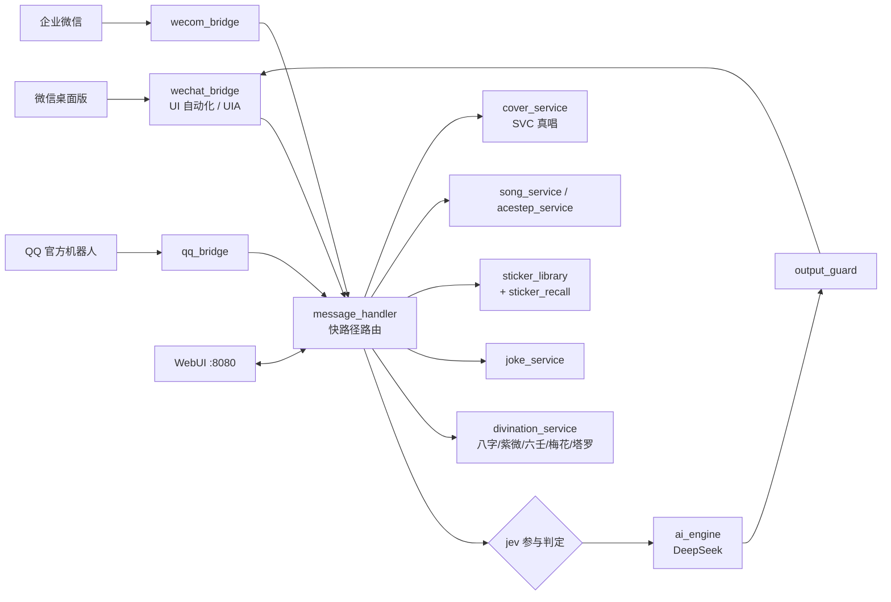

# 鲸鱼娘 · 微信 / QQ / 企业微信 多端 AI 聊天机器人（改造版）

> 一个跑在 Windows 桌面上的「傲娇鲸鱼娘」群聊机器人：DeepSeek 对话 + 本地语音识别 +
> 语音/真唱翻唱 + 本地表情包 + 算命 / 塔罗 / 讲笑话 + Web 控制台 + 看门狗。
>
> 本仓库是 **[linxisama/deepseekgirl](https://github.com/linxisama/deepseekgirl)** 的二次开发版，
> 2026-10-15 ~ 10-19 期间做了约 20 轮改造：接入三端、修通发送链路、加真唱、加算命/塔罗/笑话、
> 加本地表情包与向量召回。**每个环节参考了谁的项目，全部列在 [CREDITS.md](./CREDITS.md)。**

---

## 一、它是什么

- **一个真的在群里用的机器人**，不是 demo：微信桌面版 UI 自动化接入，群里 @ 它就回，
  能发文字、语音条、图片、文件。
- **人设固定**：`style.locked: tsundere_whale_girl`，配置层、桌面界面、Web API 三层锁死，
  改不了（上游设计如此）。
- **本地优先**：语音识别、歌声音色、表情包、塔罗牌面、排盘全在本地/本机服务里跑，
  只有对话与断命文字走大模型 API。

## 二、功能清单

| 能力 | 实现 | 说明 |
|---|---|---|
| 多端接入 | 微信（UI 自动化）/ QQ 官方机器人（WebSocket）/ 企业微信 | 三端共用同一套人设与安全策略，队列/上下文/去重各自独立 |
| 对话 | DeepSeek（OpenAI 兼容协议，也支持 Anthropic 兼容格式） | WebUI 填 Key，Fernet 加密落盘 |
| 本地语音识别 | faster-whisper `base` int8 | 语音不上传第三方；模型首次运行自动下载 |
| 说话 | edge-tts（`zh-CN-XiaoxiaoNeural`）+ SAPI5 兜底 | 按「内容+参数」哈希缓存，重复请求毫秒级 |
| 语音条 | 点微信语音按钮 → 虚拟声卡回录 → 发送 | 含「绿色发送键」判据，失败自动取消录音态 |
| 点歌真唱 | SVC 翻唱（demucs 分轨 → SVC 换音色 → 混音） | GPU 串行队列，一段 30 秒走语音条、整首走文件 |
| 唱歌 | ACE-Step 端到端出歌 / SoulX-Singer 零样本 SVS / TTS 抬调兜底 | 三级回退 |
| 表情包 | 本地库 700+ 张，标签 + 向量双召回 | 「发个黑丝」「发个鲸鱼的」能精确命中 |
| 算命 | 八字 / 起卦 / 黄历 / 紫微 / 小六壬 / 梅花易数 / 塔罗 | 盘面 100% 本地算，断语走规则，模型只组织语言 |
| 讲笑话 | 42 条「大肥鱼」梗 + 自动配图 | 按房间避重，配图用向量召回 |
| 开机补消息 | 历史回放里的消息 → 每个会话一句 | 有人 @ 必接；没人叫攒 3 条才冒泡；间隔 <60 分钟不补 |
| Web 控制台 | FastAPI + WebSocket，`127.0.0.1:8080` | 状态/日志/配置/在线发文本发图/Token 实时显示 |
| 看门狗 | `supervisor.py` | 进程退出 / 心跳停止 / 桥接异常自动重启 |
| 输出护栏 | 正则 + 词表，四态（allow/retry/fallback/block） | 堵复读、助手腔、自称模型、越界攻击 |

## 三、架构



**消息处理顺序（快路径，从上到下命中即返回）**

```
A-0.0 算命/塔罗 → A-0 点歌真唱 → A-0.5 讲笑话 → A-1 曲库话术
 → 表情包请求 → 寒暄模板 → 唱歌/点歌 → AI 主流程（带输出护栏）
```

顺序是踩出来的：真唱抢过「能唱什么歌」、曲库话术抢过点歌、算命触发词是「包含」判定
导致 `算个命` 漏掉，这些都在 [CREDITS.md](./CREDITS.md) 与文档里有记录。

## 四、快速开始

**环境**：Windows 10/11 64 位 · Python 3.12（项目自带 `.venv`）· 微信桌面版 4.x（保持窗口可见、已登录）

```powershell
# 1. 解压/克隆到固定目录，例如 D:\鲸鱼娘
#    注意：路径里有中文也能跑，但不要放在 OneDrive 同步目录

# 2. 装依赖（自动建 .venv）
.\一键安装所有依赖.bat

# 3. 启动（带看门狗，崩溃自动重启）
.\一键启动机器人-防崩溃.bat
```

启动后：

1. 浏览器打开 `http://127.0.0.1:8080/`；
2. 在页面填 **API 地址 / Key / 模型名**，点「保存配置」→「测试 API」；
3. 添加要监控的群名（与微信显示名一致），确认微信窗口可见。

> 只起网页控制台：`start-web.bat`；只起机器人：`start.bat`；
> 停止 / 看状态：`停止-鲸鱼娘.bat` / `状态-鲸鱼娘.bat`。

**可选组件**（不装也能跑，对应功能自动降级）：

| 组件 | 用途 | 装法 |
|---|---|---|
| faster-whisper 模型 | 语音转文字 | 首次运行自动下载（`asr.model_dir`） |
| jevos（`feder-cr/jev`） | 参与判定（该不该插话） | 跑 `jev.exe serve` 在 `127.0.0.1:8017`，挂了自动退回概率判定 |
| VB-CABLE 虚拟声卡 | 把音频录成微信语音条 | 装好后把默认录音设备设为 `CABLE Output` |
| ACE-Step / SoulX-Singer | 唱歌、真唱 | 各自独立的 conda 环境，见 [docs/](./docs/) |
| LX Music Web（洛雪） | 点歌下载原曲 | 填 `service` 地址即可 |
| bge-small-zh-v1.5 | 表情包/梗图向量召回 | 首次调用自动加载（`HF_HUB_OFFLINE=1` 可离线） |

## 五、目录结构

```
whalegirl-bot/
├─ main.py                    # 机器人主程序（三端装配）
├─ supervisor.py              # 看门狗
├─ web_main.py / ocr_worker.py
├─ src/
│  ├─ message_handler.py      # 快路径路由（最大的一块）
│  ├─ wechat_bridge.py        # 微信 UI 自动化 + 数据库回读
│  ├─ voice_sender.py         # 语音条发送
│  ├─ cover_service.py        # 点歌真唱（SVC）
│  ├─ song_service.py / singing_service.py / acestep_service.py
│  ├─ divination/             # 八字 · 卦 · 紫微 · 小六壬 · 梅花 · 塔罗
│  ├─ joke_service.py / sticker_library.py / sticker_recall.py
│  ├─ jev_judge.py / output_guard.py
│  └─ web/                    # FastAPI + 静态页
├─ styles/                    # 人设（含锁定的 tsundere_whale_girl）
├─ scripts/                   # 回归脚本（见 scripts/README.md）
├─ docs/                      # 设计、实测、接入文档（见 docs/README.md）
├─ 塔罗牌/                    # 78 张 RWS 牌面 + 标签
├─ 曲库/                      # 自备原曲（本仓库只带别名表）
├─ 风格语料/                  # 吐槽库/梗话库
└─ data/jokes.json            # 笑话种子（运行期数据不入库）
```

## 六、关键设计（踩出来的）

- **发送顺序**：会话已打开 → UIA 直接输入（1.8s）；未打开 → UIA 切会话并校验会话名（6.2s）；
  都不行才退回 `SendMsg` / OCR。旧顺序会偶发「输入框探测失败→静默丢消息」。
- **发送后必须回读数据库**：日志说「已发送」不代表落地。语音消息的 `create_time`
  比点发送早 2—6 秒，基准要用「开始录音 − 5 秒」。
- **坐标按内容区边缘锚定**，不按窗口比例：主窗口和渲染子窗口有 11px 内缩，
  按比例换算会让发送键偏 11px。
- **UIA 一次失败会永久降级**：已加 15 秒冷却重试 + 后台重连线程；微信重启后要先热激活
  UIA（`scripts/_probe_uia.py`）再让 bot 连微信。
- **真唱缓存键 = 歌名 + 模式（一段/整首）+ 音色版本**；改混音配比必须同时改 `voice_version`。
- **子进程 cwd 不同**：调 `cover.py` / `sing_once.py` 时产物路径必须 `.resolve()` 成绝对路径，
  否则成功会被判成失败。
- **改 `.ps1` 会丢 UTF-8 BOM**，Windows PowerShell 5.1 随后按 GBK 解析，报一堆假语法错，
  改完必须用 `WriteAllText(..., UTF8Encoding($true))` 重写 BOM。

## 七、能力边界（诚实版）

- **音色是借来的**：真唱现在用的是 SoulX-Singer 公开测评集里的一段 5.9 秒女声
  （`ZH_SPK_11_0.wav`），不是她说话的 edge-tts 晓晓。技术上「换音色」成立，
  产品上「鲸鱼娘到底什么声音」还没定。
- **曲库只有 60 多首**：周杰伦/陈奕迅大部分点不到，需要自己往 `曲库/` 丢原曲或在别处补。
- **频宽天花板**：SVC 人声 12 kHz 以上能量为 0（24 kHz 采样决定），成品听着偏闷，调参救不了。
- **移调与音程**：伴奏联动移调误差 ≤0.06 半音，但音程一致率 86% 左右，不是严格复刻。
- **微信版本敏感**：4.x 的 UI 自动化依赖控件树与坐标，微信大版本更新后需要重新校准。
- **反人类操作风险**：UI 自动化会真实点击你的微信窗口，**建议只在测试号/测试群上跑**，
  并控制频率。

## 八、文档

| 文档 | 内容 |
|---|---|
| [CREDITS.md](./CREDITS.md) | **每个环节参考了谁的项目、许可证、怎么用的** |
| [NOTICE.md](./NOTICE.md) | 上游授权状况、第三方组件、数据来源与隐私说明 |
| [docs/README.md](./docs/README.md) | 安装记录、人格改造方案、真唱接入、算命调研与实测 |
| [scripts/README.md](./scripts/README.md) | 回归脚本清单与用法 |

## 九、参考与致谢（摘要）

完整的按环节清单见 **[CREDITS.md](./CREDITS.md)**，这里只列最关键的十个：

1. **[linxisama/deepseekgirl](https://github.com/linxisama/deepseekgirl)**（B 站「西莲寺紫不是败犬」）—— 整个项目的底座。
2. **[cluic/wxauto](https://github.com/cluic/wxauto)**（Apache-2.0）+ `wechatauto-replica` —— 微信 UI 自动化。
3. **[SYSTRAN/faster-whisper](https://github.com/SYSTRAN/faster-whisper)**（MIT）—— 本地语音识别。
4. **[rany2/edge-tts](https://github.com/rany2/edge-tts)**（LGPL-3.0）—— 说话与「念唱」。
5. **[feder-cr/jev](https://github.com/feder-cr/jev)**（MIT）—— 「这句话该不该接」的本地判定。
6. **[Soul-AILab/SoulX-Singer](https://github.com/Soul-AILab/SoulX-Singer)**（Apache-2.0）—— 零样本歌声与 SVC 翻唱。
7. **[ace-step/ACE-Step](https://github.com/ace-step/ACE-Step)**（Apache-2.0）—— 歌词直接出成品歌。
8. **[facebookresearch/demucs](https://github.com/facebookresearch/demucs)**（MIT）—— 人声/伴奏分离。
9. **[6tail/lunar-python](https://github.com/6tail/lunar-python)**（MIT）+ **[SylarLong/iztro](https://github.com/SylarLong/iztro)**（MIT）—— 八字与紫微排盘。
10. **[lmy414/ai-girl-stickers](https://github.com/lmy414/ai-girl-stickers)**（MIT）+ **[梗鲸 aigengtu.com](https://aigengtu.com/)** —— 表情包与「大肥鱼」梗库。

另外，人设与行为设计大量参考了 **[PallasBot/Pallas-Bot](https://github.com/PallasBot/Pallas-Bot)**、
**[AstrBot](https://github.com/AstrBotDevs/AstrBot)**、**[personification](https://github.com/luojisama/personification)**、
**[mio](https://github.com/HuanCheng65/mio)** 等项目的公开做法——**只借鉴思路与参数，没有复制它们的代码**。

## 十、授权与免责

- 本仓库的上游 `linxisama/deepseekgirl` **没有附带 LICENSE 文件**，因此本仓库无法声明
  整体许可证，详见 [NOTICE.md](./NOTICE.md)。**仅供学习与个人测试使用。**
- 微信 UI 自动化属于非官方接口，存在**封号风险**，请用测试号、控制频率，自负后果。
- 算命、塔罗、黄历输出仅为**娱乐**，不构成任何医疗、投资、法律或人生建议。
- 群聊内容、API Key、微信 ID 等**都不入仓库**；运行期数据在 `data/` `logs/` 下，已 gitignore。
